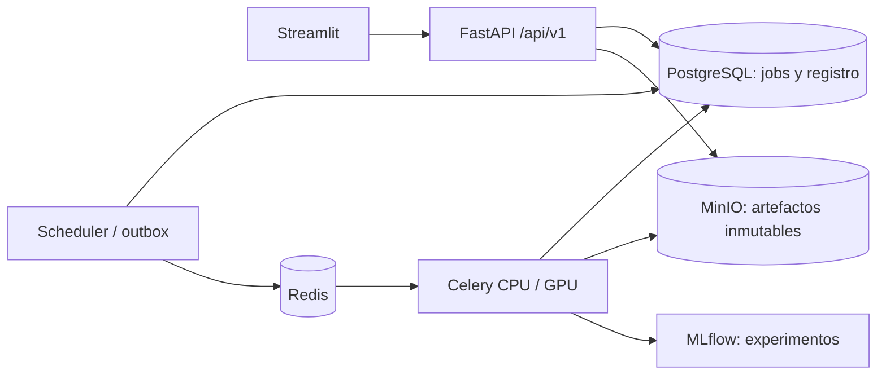

# Markowitz · AI Research Platform

Plataforma de investigación de carteras que conserva el motor Markowitz del proyecto y agrega datos Yahoo Finance en USD, modelos LSTM/MLP/GJR-GARCH, experimentos reproducibles y backtesting temporal. Las señales de IA estiman retornos o riesgo; no se presupone que superen al benchmark histórico.

La interfaz Streamlit utiliza FastAPI para todas las operaciones de negocio. Los entrenamientos, descargas, inferencias, optimizaciones y backtests se ejecutan en workers independientes:



## Iniciar la plataforma

Requiere Docker Engine y Docker Compose 2.24.4 o posterior. Los comandos siguientes usan la configuración de desarrollo, cuyos puertos administrativos están limitados a loopback:

```bash
export LOCAL_UID="$(id -u)" LOCAL_GID="$(id -g)"
docker compose config --quiet
docker compose build
docker compose up -d --wait
```

Abrir Streamlit en `http://localhost:8502`, FastAPI en `http://localhost:8000/docs`, MLflow en `http://localhost:5005` y la consola MinIO en `http://localhost:9001`. La UI no necesita ejecutar entrenamiento al abrirse.

Para el primer uso:

1. En **Data Management**, importar el histórico del proyecto o actualizar un universo Yahoo.
2. Consultar el job y activar el dataset validado. El import histórico ya lo activa; un refresh manual es candidato salvo que se solicite activación.
3. En **Model Laboratory**, elegir dataset, familia, tickers y parámetros, y lanzar el entrenamiento.
4. Revisar métricas de validación y artefactos antes de activar una versión aceptada.
5. En **Portfolio Optimizer**, fijar dataset, universo, modelos, bloques y restricciones.
6. Comparar resultados y realizar una evaluación temporal desde **Backtesting**.

**Dashboard**, **Portfolio Analytics**, **History & Experiments** y **System & Diagnostics** muestran estados y resultados obtenidos desde la API. Una respuesta HTTP 202 indica un trabajo aceptado, todavía pendiente de ejecución y publicación.

Ver [despliegue, producción, GPU y recuperación](docs/platform-deployment.md) para secretos, healthchecks, backups y configuración completa. Producción usa `docker-compose.production.yml`, sin Adminer ni puertos administrativos publicados; requiere secretos propios y un proxy TLS/autenticación delante de Streamlit.

## Datos y convenciones financieras

Yahoo Finance admite universos distintos de los 40 activos originales. Los universos guardan tickers, estado habilitado, bloques y metadata editable; el preset histórico conserva AR, US, FUNDS_EQUITY, FUNDS_BONDS y GOLD. Los bloques también pueden ser `OTHER` o nombres personalizados. El preset asigna `GLD` a GOLD y permite una modificación explícita del usuario.

La nueva aplicación recibe datasets registrados en PostgreSQL y almacenados en MinIO. Cada job fija una versión al enviarse: una actualización o rollback posterior no cambia sus datos. Los CSV y punteros locales anteriores se consultan únicamente durante el import explícito o mediante scripts de compatibilidad; no son una segunda fuente activa de las páginas nuevas.

- Moneda base **USD**, antes de calcular retornos logarítmicos diarios.
- Acciones cotizadas en ARS: conversión histórica mediante CCL, con fuente y fecha auditables. Un ADR ya cotizado en USD no se convierte nuevamente.
- No se inventan retornos de feriados. La covarianza histórica usa observaciones coincidentes por par con mínimos de historia y solapamiento.
- Matrices simétricas, diagnósticos de autovalores/condicionamiento y regularización PSD controlada.
- `mu_pred` representa retorno logarítmico **medio diario** de las cinco ruedas futuras. `forecast_log_return_5d` es el acumulado; `expm1` lo transforma a retorno simple acumulado.
- `sharpe_annual = sharpe_daily * sqrt(252)` para entradas diarias. El retorno logarítmico anual y su transformación a retorno simple se identifican por separado.

[Datos, moneda, features y modelos](docs/dynamic-models.md) describe la metodología. Los CSV históricos incluidos conservan 40 activos y 2061 observaciones, del 2018-01-03 al 2025-12-31; no necesariamente coinciden con la versión activa.

## Modelos y selección de señales

| Familia | Función | Evidencia conservada |
| --- | --- | --- |
| LSTM | Retorno medio diario a cinco ruedas | Arquitectura, features, escaladores, checkpoints de evaluación/refit, curvas y métricas train/validation/test |
| MLP | Retorno medio diario a cinco ruedas | Pipeline, preprocesamiento, features, métricas temporales y criterios de validación |
| GJR-GARCH | Volatilidad diaria y horizonte de cinco ruedas | Parámetros, especificación, distribución, convergencia, diagnósticos y comparación con EWMA |

El preset LSTM conserva ventana de 40 ruedas y horizonte de cinco. La búsqueda compara 64→64 y 120→64, activaciones ReLU/Tanh/GELU de la capa densa y configuraciones Adam; selecciona con validación temporal. El test se utiliza para evaluación final. Escalado y winsorización se aprenden con train y se purgan targets superpuestos en los bordes temporales.

Las señales LSTM exigen por defecto dirección de validación `> 0.52`, amplitud `> 0.15` y el filtro del productor frente al baseline. El optimizador registra los umbrales efectivos y el motivo de cada aceptación o rechazo. Una señal faltante o caducada utiliza media/volatilidad histórica según la política; `required` exige cobertura válida. Versiones, moneda o unidades incompatibles se rechazan. Un MLP antiguo sin evidencia de validación no se activa como señal.

Los modelos aceptados quedan `validated`; los demás, `rejected`. Activar una versión es una operación separada y reversible. Los bundles verificados contienen pesos/parámetros y preprocesamiento completos en MinIO, no sólo un CSV de pronósticos. MLflow es obligatorio para publicar experimentos por defecto; deshabilitarlo requiere `PLATFORM_MLFLOW_REQUIRED=false` explícito para un entorno que admita esa limitación.

## Optimización y evaluación financiera

Los modos `classic`, `ai_returns` (MLP), `ai_returns_lstm` y `ai_volatility` comparten el mismo motor. La API también admite `combined`, o retornos LSTM junto con covarianza GJR-GARCH, con trazabilidad independiente de ambas fuentes. Las predicciones utilizadas deben corresponder al dataset fijado y tener fechas compatibles.

Antes de resolver se verifican objetivos que sumen 100%, no negatividad, cobertura y capacidad de cada bloque (`n_activos * max_weight >= target`), etiquetas, dimensiones, matrices y compatibilidad de señales. Los errores de configuración se informan como HTTP 422 o como fallo detallado del job si se detectan durante su ejecución.

Se muestran por separado la frontera clásica long-only sin objetivos por bloque/tope por activo y la frontera restringida que replica las condiciones de la cartera. Los estimadores de covarianza disponibles son histórico por pares, Ledoit-Wolf sobre fechas conjuntas observadas y correlación histórica regularizada con volatilidades GJR-GARCH. Ledoit-Wolf rechaza solapamiento conjunto insuficiente en lugar de imputarlo.

Los resultados incluyen pesos, exposiciones, MinVar/MaxSharpe, Sharpe diario/anual, concentración HHI, contribuciones al riesgo y escenarios históricos VaR/ES/drawdown. Las estimaciones ex ante se distinguen de las métricas realizadas ex post.

El backtest walk-forward compara `classic`, `lstm`, `mlp`, `gjr_garch`, `combined`, `equal_weight` y `buy_and_hold`. Cada fold ajusta modelos usando sólo historia disponible; no carga pesos actuales para decisiones pasadas. Replica restricciones, políticas y estimadores, y aplica pesos al retorno posterior a la decisión, con costos, comisiones y slippage configurables. Los benchmarks pueden configurarse con restricciones comparables. Se guardan decisiones, checkpoints, curvas y reportes en el bundle del backtest.

La selección actual del universo y metadata no elimina sesgo de supervivencia. Los retornos faltantes de una posición mantenida rechazan la simulación; este motor no inventa precios para conciliar mercados. Un backtest corto comprueba el flujo, pero no demuestra superioridad predictiva.

## API y operación

Los endpoints de dominio están bajo `/api/v1`: datasets/universos, experimentos/modelos, optimizaciones, backtests, jobs, artefactos y diagnóstico. Los jobs tienen UUID, estado SQL durable, progreso cuando existe un checkpoint, logs, tiempos, recursos, timeout y cancelación cooperativa antes de la confirmación final.

El scheduler despacha el outbox SQL a Redis y recupera leases vencidos. Los reintentos distinguen errores transitorios y permanentes; una entrega duplicada no vuelve a reclamar un job ya ejecutándose. El refresh Yahoo es diario por defecto (`YAHOO_REFRESH_INTERVAL_SECONDS=86400`); `YAHOO_REFRESH_ENABLED=false` lo deshabilita. No depende de abrir Streamlit.

Las rutas de compatibilidad `/optimize` y `/jobs` siguen disponibles; la optimización HTTP productiva ahora devuelve **202 y un job**, en lugar de ejecutar el solver dentro del request. `/runs` conserva acceso al historial anterior. Ver [arquitectura y migración](docs/platform-architecture.md) para contratos, publicación y límites operativos.

Los scripts CLI históricos se conservan para investigación y mantenimiento. Sus archivos locales y los artefactos del workflow anterior de Yahoo no activan automáticamente versiones en el nuevo registro SQL/MinIO. No mezclar ese mecanismo con una publicación de la plataforma.

## Pruebas y estado de verificación

```bash
python -m pip install -r requirements-dev.txt
python -m pytest -q --ignore=tests/integration
ruff check src api app worker tests --select E9,F63,F7,F82,F821
python -m compileall -q src api app worker scripts
```

CI incluye una integración con PostgreSQL, Redis, Celery, MLflow y MinIO reales: entrena configuraciones pequeñas de las tres familias, recupera artefactos y verifica persistencia tras reiniciar API/worker. El harness está en `scripts/platform_integration.py`; ver los comandos y el alcance en [despliegue](docs/platform-deployment.md).

En el entorno de implementación Docker denegó acceso al socket. Preparar el workflow no equivale a haber validado el despliegue: los builds, healthchecks y ambas fases de integración deben pasar en CI o en un host habilitado. Los resultados históricos y la verificación de mejoras anteriores se conservan en [el plan de mejoras](docs/improvement-plan.md).

La evidencia ejecutada y sus límites están en [Verificación de Platform 2.0](docs/platform-verification.md).
