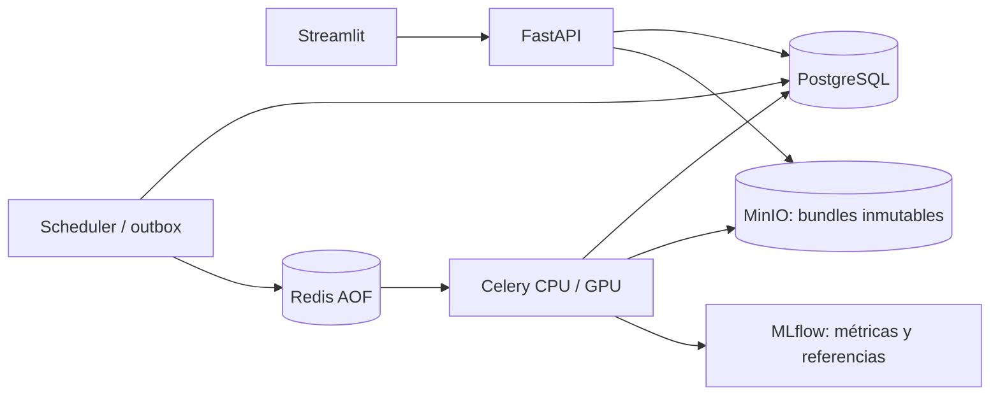

# Plataforma V2: despliegue y operación

La UI consulta la API; los entrenamientos, inferencias, refresh y backtests corren
en Celery. PostgreSQL conserva jobs, outbox, universos, experimentos y referencias
activas. MinIO es la fuente canónica de datasets y bundles de modelos; cada
materialización verifica su manifiesto y hashes. Los directorios de trabajo son
temporales y pueden descartarse al recrear API o workers.



## Desarrollo

Requiere Docker Engine y Compose 2.24.4 o posterior; la integración utiliza
`!override` y `!reset`. Las imágenes incluyen los CSV históricos de `Data/`,
incluyendo `assets_metadata.csv`, `prices.csv`, `returns.csv` y `fx_CCL.csv`.
Los outputs históricos, pesos, credenciales y caches locales quedan fuera de la
imagen. El import explícito copia y valida el legado hacia MinIO y SQL.

```bash
export LOCAL_UID="$(id -u)" LOCAL_GID="$(id -g)"
export CODE_VERSION="$(git rev-parse HEAD)"
docker compose config --quiet
docker compose build
docker compose up -d --wait
docker compose ps
```

`app/` completo, `src/`, `api/`, `worker/`, `scripts/` y `.streamlit/` se montan
read-only para desarrollar la UI y sus páginas sin reconstruir la imagen. `Data/`
se monta read-only únicamente en API y workers para el import del legado; refresh
y entrenamiento publican nuevos objetos en MinIO. Si el checkout pertenece a otro
UID, configurar `LOCAL_UID` y `LOCAL_GID` para que los procesos puedan leerlo.

| Servicio | Acceso local |
| --- | --- |
| UI | `http://localhost:8502` |
| API / OpenAPI | `http://localhost:8000/docs` |
| MLflow | `http://localhost:5005` |
| MinIO / consola | `http://localhost:9000` / `http://localhost:9001` |
| Adminer, sólo desarrollo | `http://localhost:8081` |
| PostgreSQL / Redis | `127.0.0.1:5432` / `127.0.0.1:6379` |

Todos los puertos de desarrollo se publican en loopback. Los defaults de
credenciales son exclusivamente locales. Dentro de los contenedores se usan los
nombres DNS `postgres`, `redis`, `minio`, `mlflow` y `fastapi`; evitar URLs a
`localhost` en las variables que consumen estos servicios.

El primer dataset se importa desde la UI o con
`POST /api/v1/datasets/import-legacy`. La respuesta HTTP 202 identifica un job;
consultar `/api/v1/jobs/{id}` hasta su estado terminal. El import activa el dataset
verificado sin modificar los CSV históricos. El scheduler ejecuta refresh diario
si `YAHOO_REFRESH_ENABLED=true`; `YAHOO_REFRESH_INTERVAL_SECONDS` controla el
intervalo, por defecto 86400. En pruebas aisladas se desactiva el proveedor.

## Workers CPU y GPU

Los comandos efectivos son:

```bash
celery -A worker.celery_app:app worker -Q cpu -c 2
python -m worker.scheduler
```

CPU es el build por defecto: Torch 2.6.0 desde el índice CPU. `TORCH_INDEX_URL`
permite cambiar el índice durante el build; no instala paquetes al arrancar.
`PLATFORM_CPU_THREADS` limita BLAS/OpenMP por proceso. Los procesos hijos se
reciclan después del límite de memoria configurado con
`PLATFORM_WORKER_MAX_MEMORY_KB`; los límites duros de RAM/CPU deben establecerse
según el host o el orquestador.

Para GPU se necesita un host NVIDIA con driver y NVIDIA Container Toolkit:

```bash
docker compose --profile gpu build worker-gpu
docker compose --profile gpu up -d worker-gpu
```

El perfil agrega un worker de cola `gpu` y concurrencia 1, con `gpus: all`.
`TORCH_GPU_INDEX_URL` usa CUDA 12.4 por defecto. Seleccionar `device=cuda` en el
entrenamiento para enviarlo a esa cola. La API, UI, scheduler y worker CPU siguen
usando sus imágenes CPU. En producción definir también `GPU_WORKER_IMAGE` con el
tag o digest revisado del build GPU.

## Producción

`docker-compose.production.yml` es un despliegue independiente. Sólo publica la
UI en `127.0.0.1:8502`; colocar un reverse proxy TLS con autenticación/SSO delante.
La API key es de servicio y no implementa identidad de usuarios de Streamlit.
Adminer queda fuera de producción; PostgreSQL, Redis, API, MLflow y MinIO no
tienen puertos publicados. Los workers disponen de salida de red para Yahoo/FX.

```bash
cp .env.production.example .env.production
chmod 600 .env.production
# Completar secretos distintos, rutas, CODE_VERSION y tags/digests de imágenes.
docker compose --env-file .env.production -f docker-compose.production.yml config --quiet
docker compose --env-file .env.production -f docker-compose.production.yml build --pull
# Primera instalación: iniciar infraestructura y provisionar bucket/cuenta MinIO.
docker compose --env-file .env.production -f docker-compose.production.yml up -d --wait postgres redis minio mlflow
docker compose --env-file .env.production -f docker-compose.production.yml up -d --wait
```

Generar secretos aleatorios; no desplegar valores `REPLACE`. `DATABASE_URL` y
`CELERY_BROKER_URL` deben incluir las credenciales correspondientes y codificar
caracteres especiales de las contraseñas para URL. Redis exige `REDIS_PASSWORD`
y persiste AOF con `appendfsync everysec`. Definir orígenes CORS explícitos y
claves de administrador/lectura diferentes. La UI recibe la clave en el servidor.

Provisionar primero el bucket `PLATFORM_ARTIFACT_BUCKET` y una cuenta MinIO de
servicio con lectura/escritura y consulta de ese bucket. Las credenciales raíz
son diferentes y sólo se usan para administración privada. No dar claves raíz a
API o workers. El bucket por defecto es `markowitz-artifacts`; no es el bucket
histórico de snapshots. Para endpoints remotos, usar TLS y configurar el endpoint
y confianza según la instalación.

En la primera instalación, provisionar la cuenta entre el arranque de
infraestructura y el arranque completo. Usar un cliente administrativo en la red
backend o un túnel privado temporal a la consola; la consola no se publica por
defecto. Una cuenta restringida al bucket precreado puede usar
`s3:ListBucket`/`s3:GetBucketLocation` sobre el bucket y
`s3:GetObject`/`s3:PutObject` sobre sus objetos. La aplicación no necesita borrar
objetos ni administrar usuarios.

API, UI, workers y scheduler usan UID 10001, root filesystem read-only, sin
capabilities y `no-new-privileges`. `/tmp`, caches y el directorio de compatibilidad
`storage/` son tmpfs descartables. `DATA_VOLUME_PATH` debe ser legible por UID
10001 y se monta read-only en API y workers. No se monta un volumen permanente
para `models_artifacts/`, checkpoints o outputs del worker. La imagen conserva
los CSV del legado como recurso de migración; no son la versión activa canónica.

| Persistencia | Datos que deben respaldarse |
| --- | --- |
| PostgreSQL | Jobs y eventos, leases, outbox, datasets, modelos, referencias activas |
| MinIO | Manifiestos y archivos inmutables de datasets, modelos y resultados |
| Redis AOF | Mensajes pendientes; SQL/outbox permite recuperación y deduplicación |
| MLflow | Backend SQLite y reportes en su volumen; modelos se referencian en MinIO |

Los volúmenes PostgreSQL, Redis, MinIO y MLflow sobreviven a `up`, `restart` y
recreación de contenedores. No usar `down --volumes` sobre un despliegue con datos
que deban conservarse. Respaldar SQL y MinIO de forma coordinada, probar restauración
en un entorno aislado y verificar hashes. Para MLflow SQLite detener su servicio
durante la copia o usar un backup transaccional. Los backups y las claves deben
almacenarse fuera del host, con una política de retención.

## Salud y recuperación

```bash
docker compose exec -T worker python -m worker.healthcheck worker
docker compose exec -T scheduler python -m worker.healthcheck scheduler
docker compose logs --tail=100 fastapi worker scheduler
```

`/health/live` comprueba liveness; `/health/ready` comprueba dependencias según la
API. `/api/v1/system` muestra servicios, workers, jobs y dataset/modelos activos.
Los healthchecks de worker y scheduler exigen un heartbeat SQL reciente de su
propio hostname. Un job registra progreso, errores y recursos en PostgreSQL.
El scheduler vuelve a despachar el outbox y recupera leases vencidos; Celery usa
acknowledgement tardío y los duplicados se comprueban en SQL. MinIO y MLflow deben
estar sincronizados antes de completar una publicación requerida; un fallo no
activa un modelo ni cambia una referencia activa a un bundle parcial.

## Integración y límites de esta verificación

CI ejecuta unitarios y un stack aislado definido por
`docker-compose.integration.yml`. El harness usa servicios reales, entrena las tres
familias con configuraciones pequeñas, verifica bundles y tracking, y contrasta
estado antes/después de reiniciar API y worker:

```bash
export COMPOSE_PROJECT_NAME=markowitz-integration
export COMPOSE_FILE=docker-compose.yml:docker-compose.integration.yml
docker compose up -d --build --wait postgres redis minio mlflow fastapi worker scheduler
docker compose exec -T fastapi python scripts/platform_integration.py --phase before-restart --state /integration/state.json
docker compose restart fastapi worker
docker compose up -d --wait fastapi worker
docker compose exec -T fastapi python scripts/platform_integration.py --phase after-restart --state /integration/state.json
docker compose cp fastapi:/integration/report.json ./integration-report.json
docker compose down --volumes --remove-orphans
```

La limpieza con `--volumes` anterior se limita al proyecto de integración aislado.
El reporte es evidencia de la ejecución cuando el harness completa ambas fases.
En este entorno se validaron las configuraciones Compose y las pruebas Python;
el daemon Docker denegó acceso al socket para UID 1000. No se construyeron imágenes
ni se ejecutó este stack aquí. Los builds, healthchecks y la integración completa
deben pasar en CI o en un host con acceso a Docker antes de promocionar.

En entornos con proxy HTTPS y CA gestionada, el override
`docker-compose.proxy.yml` monta el bundle público sólo durante el build:

```bash
export PROXY_CA_BUNDLE=/etc/ssl/certs/ca-certificates.crt
docker compose -f docker-compose.yml -f docker-compose.proxy.yml build
```

Se preservan proxy y credenciales del cliente Docker. Los Dockerfiles usan
`PIP_CERT` en los pasos de instalación; el certificado no queda copiado en capas.
No desactivar verificación TLS. La variante de producción puede combinar el mismo
override y `--env-file .env.production`.
